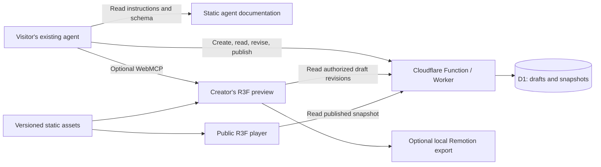

# Route Replay Web implementation plan

Drafted November 10, 2026; updated November 11, 2026. This is a proposed design, not an implemented contract. Endpoint names, schema fields, and numerical limits below are initial choices to validate during the prototype.

## Product

Build a free web app, maintained by Nathan, that opens on a React Three Fiber scene of Earth. People create and revise journeys by prompting an agent they already use. The agent researches the itinerary, submits a structured JSON specification, inspects feedback, and revises the scene. A published permalink lets anyone with a supported graphics browser watch the result. Video export runs on the creator's device when supported.

The only authoring interface is the agent interface. The page provides the visual preview and ordinary playback, sharing, and export controls. It does not need an itinerary form, JSON editor, chat box, plugin installation, or ChatGPT account integration.

The latest design follows Proof's agent-facing HTTP approach. WebMCP is an additional interface to the live page; it is not a prerequisite for creation. An agent must be able to make authorized HTTP writes or use the page's WebMCP tools. A chat system that can only read URLs cannot complete the creation workflow.

## First complete experience

1. A visitor sees Earth and a Get Started action with a copyable prompt. It points to Route Replay's agent documentation and asks compatible agents to offer an optional skill installation for future use.
2. They ask their agent: “Read Route Replay's instructions and recreate my Chicago–San Francisco–Auckland trip from this itinerary.”
3. The agent follows the hosted instructions, offering installation if supported and not already installed. Whether installation is accepted, declined, unavailable, or fails, creation can continue directly. The agent reads the current schema and example, resolves the airports and dates, asks about material ambiguity, and calls the create endpoint with a scene spec.
4. The service validates the spec and returns a private editing link, draft ID, revision, and edit credential. The agent gives the creator the editing link.
5. The creator opens the preview and asks their agent to slow a leg, change a camera preset, or adjust a stop. The agent reads the current spec and replaces it with a revised spec. The open preview refreshes to that revision.
6. When asked to share, the agent publishes a snapshot and returns a public watch link. Sharing does not expose editing credentials or the original itinerary attachment.
7. On a capable device, the creator can export the scene to a local video file. A failed or unsupported export leaves playback and sharing usable.

The agent's existing service supplies its model and research capabilities. Route Replay does not pay for model inference in this design. This does not imply the agent or external research providers are free for the visitor.

## Scope

### Initial release

- Flights between known airports, including connected journeys and repeated visits.
- A browser-native Earth with day/night textures, dated sunlight, a lightweight atmosphere, route trails, airport labels, and one modest aircraft asset.
- Globe and aircraft-follow camera presets with bounded presentation settings.
- Deterministic playback, pause, seek, replay, and responsive framing.
- HTTP creation and revision, machine-readable documentation, and useful validation errors.
- An optional installable skill offered through Get Started, with the same workflow available without installation.
- Private draft access, explicit publication, immutable public snapshots, and creator deletion.
- Optional WebMCP controls on the live preview.
- Optional browser video export after a compatibility prototype passes.

### Deferred

- Server rendering, render queues, hosted video storage, and an AI backend.
- Visual parity with the Python/Blender atmospheric renderer.
- Automatic acquisition of actual flight tracks or historical weather.
- User-uploaded media, custom models, arbitrary shaders, and executable scene code.
- Collaborative comments, per-character provenance, social feeds, and account libraries.
- General video editing, full Remotion Studio UI for visitors, and a timeline editor.
- Other transport modes until their route and timing semantics are designed.

The agent handles research and clarification with the creator. Route Replay accepts the resulting scene parameters and validates their structure, consistency, and renderability. Research citations and evidence records stay outside the scene specification.

## Architecture

Use React, TypeScript, Vite, Three.js, and React Three Fiber for the frontend. Host static files on Cloudflare Pages. Use a small Pages Function or Worker for validated writes and D1 access. Make one deployment arrangement work before adding another. If Pages imposes a concrete integration limitation, evaluate Workers Static Assets without changing the public API contract.

Keep four responsibilities separate: scene validation and normalization; deterministic timeline/geometry calculations; the R3F scene; persistence and authorization. HTTP and WebMCP call the same application operations. Do not introduce a remote MCP server merely to expose page tools.

Remotion Studio is a development tool. Evaluate `@remotion/three`, the Player, and `@remotion/web-renderer` together in the first rendering prototype. Share scene components and the timeline between playback and export; lazy-load export dependencies. An idle Earth view may use its own lightweight animation, while journey playback must follow the saved timeline.

## Scene specification

Publish a versioned JSON Schema, a small synthetic example, and agent-readable field descriptions. Accept only data, with named asset and camera presets. Unknown fields and unsupported versions produce explicit errors.

The minimum contract should describe:

| Area | Proposed contents |
| --- | --- |
| Version | `schemaVersion` |
| Journey | Ordered legs with stable IDs, airport IDs, departure and arrival UTC timestamps |
| Route | Initially generated great-circle paths; optional supplied coordinates in a later version |
| Presentation | Duration, aspect ratio, camera preset, per-leg pacing weights, per-stop holds |
| Environment | Explicit weather treatment; initially `omitted` |
| Assets | Approved aircraft/style preset IDs |
| Reproducibility | Seed, pinned renderer version, and asset manifest version in the normalized record |

Keep the authoring spec compact. The service normalizes airport coordinates and time zones from a versioned lookup, resolves defaults, and returns the normalized result. Derived routes, solar positions, and camera curves come from code. The agent should not generate meshes, shader code, frame-by-frame camera arrays, or encoded media.

Validation covers finite values, coordinate/time bounds where accepted, ordered timestamps, connected legs, unique leg IDs, duration budgets, supported presets, and size limits. Date-line crossings and daylight-saving conversions must have explicit tests. Require offset-aware timestamps; normalize to UTC. The agent resolves missing or ambiguous times with the creator before submitting the spec.

Default routes are generated great-circle paths. Future supplied-route support should retain the coordinates, timestamps, and gap handling needed to animate them. The spec describes how to construct the scene; it does not include source URLs, per-leg evidence records, or research provenance. Schema, renderer, and asset versions remain for compatibility and reproducible playback.

### Time and presentation

The central rule is `scene = evaluate(normalizedSpec, presentationTime)`. Rendering the same timestamp must not depend on previously rendered frames, playback speed, wall-clock time, or unseeded randomness.

Presentation time maps to physical journey time. Sunlight uses physical time. A positive layover hold animates the complete real connection with the aircraft and camera stationary at the airport; a zero-length hold is an explicit time cut. Any future weather replay gets its own clearly identified sampling clock.

Device quality can change pixel density, texture resolution, and effects. It must not change journey timing, route facts, or seed. Pixel-identical output across different GPUs is not promised.

Carry forward the existing renderer's restraint: airport codes are the default scene text; an optional trip title belongs outside the rendered scene. Telemetry and media remain opt-in. Repeated airport visits need separate label lifetimes. Scene text must remain legible at phone size.

## Agent API

Use a small, versioned HTTPS JSON API. The following routes are proposed:

| Route | Purpose | Access |
| --- | --- | --- |
| `GET /agent-docs` | Concise workflow, schema links, examples, errors, limits | Public |
| `GET /schemas/scene-v1.json` | Authoring JSON Schema | Public |
| `POST /api/v1/scenes` | Validate and create a private draft | Anonymous, rate-limited |
| `GET /api/v1/scenes/:id` | Read normalized spec, revision, capabilities | Draft credential |
| `PUT /api/v1/scenes/:id` | Validate and replace the spec with `expectedRevision` | Edit credential |
| `POST /api/v1/scenes/:id/publications` | Publish the specified revision as a snapshot | Owner credential |
| `GET /api/v1/publications/:id` | Fetch a published snapshot | Public |
| `DELETE /api/v1/scenes/:id` | Delete draft and associated publications | Owner credential |

Creation returns the draft ID, revision, private preview link, edit credential, and distinct owner credential. Never return credentials from subsequent ordinary reads. Store credential hashes, not plaintext bearer tokens, on the service. Return machine-readable capabilities so agents do not infer authority from URL shape.

Use `Authorization: Bearer` for API credentials. Design the private browser handoff with a token in the URL fragment, exchange it for a secure session, and remove the fragment from browser history. Avoid tokenized query strings and redact credentials from logs. The public watch URL is always credential-free. Exact credential storage, recovery, and revocation behavior is a milestone-one design decision, not something to improvise during deployment.

Successful updates return the new revision and normalized spec. Invalid requests return field paths, error codes, and repair hints without changing the current scene. Revision conflicts return the current revision and enough state to retry intentionally. Use atomic compare-and-swap writes and idempotency keys on creation/publication so retries do not produce duplicate resources. Define key scope and retention before implementation.

Initial abuse bounds to test: 64 KiB authoring payload, 12 legs, 120 seconds of presentation time, and capped text lengths. Apply limits on the server. Use explicit `429` responses and retry hints. Do not make a human CAPTCHA the routine agent API path; determine an abuse response that keeps authorized agent creation usable.

### Discovery

The landing page provides this copyable Get Started prompt, with the deployed absolute documentation URL substituted for the placeholder:

> Help me create a journey in Route Replay. Read [agent instructions URL]. If you support installing skills and the Route Replay skill is not already installed, offer to install it for future use. Otherwise, follow the instructions directly. Continue helping me create the journey whether or not I install the skill.

A preview or watch URL should advertise the appropriate JSON endpoint and schema in a readable response; content negotiation is optional if it complicates caching. Credential-free responses expose only public capabilities and published data.

### Optional installable skill

Include a small downloadable `SKILL.md` package in the initial release. Its purpose is to make repeat sessions easier: resolve itinerary ambiguity, choose sensible pacing and camera defaults, submit a valid scene, repair validation errors, and revise the existing journey when the creator asks for changes.

Maintain the workflow in one source and use it for both `/agent-docs` and the installable package. Keep current API endpoints, schemas, and detailed field definitions in the hosted documentation; the skill links to and fetches those contracts when needed instead of embedding copies that become stale. Include a skill version so updates are identifiable.

Installation is optional and follows the host agent's supported installation mechanism and the user's choice. Do not require a plugin, automatically overwrite an existing skill, or repeatedly offer installation during the same creation session. If installation is unsupported, declined, or fails, use the hosted instructions and continue through HTTP or available WebMCP tools. Installing instructions does not give an agent missing HTTP-write or browser capabilities.

The package contains reusable instructions only; journey specs and editing credentials stay outside its files. Use a distinct package name such as `routereplay-web` to avoid replacing the existing offline `route-replay` skill. Do not claim compatibility with an agent until it has completed a real create/revise/publish test.

## WebMCP and live preview

Feature-detect the supported API and register a small tool set on the authorized creator page:

- `get_scene`: spec, revision, supported options, and validation state.
- `set_scene`: atomic validated replacement using the expected revision.
- `seek_scene`: seek/pause to inspect a precise presentation timestamp.
- `publish_scene`: create a snapshot only with owner authority and an explicit publish request.

Tools reuse browser session permissions. Public watch pages expose no write tools. A tool response should identify the applied revision and whether assets are ready; a successful save does not alone prove a rendered preview is ready. Preserve the previous working scene if an update fails.

HTTP edits must also appear in an already-open preview. Begin with visibility-gated, bounded polling while the creator is actively iterating; pause it when idle or hidden. Measure request consumption before choosing intervals. Conditional responses reduce transferred bytes but do not eliminate Worker invocations. Evaluate push updates only if polling cost or latency warrants the additional infrastructure.

Persist draft revisions server-side and keep local undo where useful. Agent calls operate against durable revisions, so closing a preview does not lose the journey. Browser-only tools such as seek require an open compatible page.

## Publication and ownership

A draft is private. Publication is an explicit operation that copies an approved normalized revision into an immutable snapshot. Later edits create a new revision and, when published, a new watch URL. A shared link therefore keeps the same itinerary and presentation.

Pin the schema, renderer, and asset versions needed to interpret published data. Define a bounded compatibility policy and test old fixtures before upgrades; do not promise indefinite pixel-identical rendering. Immutability of content does not prevent owner deletion. Deleted links should return a clear unavailable state, with cached copies purged or bounded by a short TTL.

The public configuration includes only the journey, presentation, environment, and compatibility fields needed for playback. Original itinerary files, booking references, passenger names, credentials, and chat history are excluded. Publishing validates the scene and access permissions; it does not audit research sources.

Start without accounts if capability credentials prove usable. Explain that losing the owner credential may remove recovery options. Account-based ownership and recovery can be added later if necessary. Document draft retention before launch; do not silently expire published links to manage storage.

## Browser rendering and export

Start with one synthetic two-leg journey and a small asset bundle. Establish measured budgets for startup transfer, frame time, GPU memory pressure, and export duration on an ordinary laptop and a representative phone.

Provide low and standard quality levels. Begin conservatively and reduce expensive effects when performance falls. Handle WebGL/context loss and show an accessible route summary if 3D cannot run. Public playback is independent of export support.

For export, check the requested codec, dimensions, and browser APIs, then run a short real scene export. Browser version detection alone is insufficient. Start with 720p, 30 fps, and short clips; add higher resolutions only after measurements. Include progress and cancellation, avoid accumulating all raw frames, and do not promise recovery after a tab closes.

Use same-origin, licensed assets and verify canvas capture, fonts, and post-processing with the actual Remotion browser renderer. Check representative decoded frames against the preview at matching timestamps. Export may take longer than real time. The completed file downloads locally; no video upload is required.

## Hosting and maintenance

Use Pages for app assets, a small API, and one D1 database for draft specs, credentials, publication snapshots, revisions, and idempotency records. Introduce R2 only when a concrete asset/storage need exceeds this arrangement. Do not upload the offline renderer's datasets or caches.

Aim for free-tier operation at modest traffic, not unlimited free service. Account for API invocations, preview polling, database operations, revision retention, asset bandwidth, and abuse. Public immutable snapshots can be cached, but deletion behavior must remain defined. Set request/storage budgets and usage visibility before launch; quota exhaustion should fail clearly without corrupting existing scenes.

Avoid third-party paid data providers in the first release. Verify redistribution and attribution for the application's Earth textures, airport lookup data, aircraft assets, fonts, and dependencies. Keep required asset credits with the application and asset manifests, separate from user journey specs. Recheck Remotion license eligibility before public release.

Operational work includes dependency updates, database migrations/backups, restore verification, credential redaction, publication deletion, and support for obsolete browser/schema versions. Keep a short runbook and avoid adding persistent services without measured need.

## Delivery sequence

| Milestone | Deliverable | Completion evidence |
| --- | --- | --- |
| 1. Contract and rendering spike | Versioned schema, synthetic fixture, deterministic timeline, basic Earth, initial Remotion export experiment; resolve capability handoff | Same timestamps survive pause/seek/export; invalid fixtures rejected; no dependence on Python/Blender |
| 2. Local agent workflow | Create/read/replace API backed by local D1, private preview, revision refresh, shared agent instructions, optional skill package, and Get Started prompt | A real HTTP-capable agent creates and revises a journey without installation; a compatible agent installs the skill and resumes the workflow in a later session |
| 3. Sharing | Explicit publication, immutable snapshots, read-only watch page, owner deletion | Public URL works in a fresh browser without credentials; draft edits do not change it; edit tokens cannot delete/publish |
| 4. WebMCP | Small live-page tools using the same operations | Compatible agent discovers tools, reads and revises scene, seeks, and receives useful errors; HTTP path still works without WebMCP |
| 5. Export and device quality | Capability-gated local video export, cancellation, quality fallback | Short decoded clip matches timeline; weak/unsupported device retains playback; context loss and cancellation handled |
| 6. Limited public launch | Cloudflare deployment, licensed asset inventory, quotas, runbook, compatibility notes | End-to-end creation and public playback on deployed URLs; storage restore/deletion checked; no secrets in public JSON or logs |

Do the export experiment in milestone one even though export ships later: capture incompatibility could change the rendering design. Deploy only when implementing the launch milestone; this planning repository creates no cloud resources.

## Verification priorities

- Unit tests for schema bounds, timezone conversion, connected-leg validation, dateline/polar routes, repeated airports, time mapping, and determinism under out-of-order seeks.
- API integration tests for authorization separation, atomic revisions, duplicate retries, publication isolation, deletion, and rate/size limits.
- Browser checks for preview refresh, empty/error states, low-quality playback, text legibility, and representative exported frames.
- One real external-agent create/revise/publish walkthrough and one WebMCP walkthrough. Mock tool calls alone do not establish usability.
- Get Started checks with installation accepted, declined, unsupported, failed, and already complete. Verify creation remains available, the installed skill reads current contracts in a later session, and hosted/package workflow instructions stay aligned.
- A saved published fixture from each supported schema version for upgrade regression checks.

## Relationship to the existing repository

Keep `../routereplay` intact as the offline renderer. Reuse concepts, selected licensed assets, synthetic fixtures, and carefully reviewed calculations where useful. Do not copy its renderer architecture, downloaded datasets, local outputs, personal trips, or Git history into this project.

Useful references are its `references/architecture.md`, `references/trip-format.md`, and `references/presentation-contract.md` under `skills/route-replay`. Porting code or assets requires inspecting their individual license and dependencies. The web JSON contract is a new versioned contract; an offline-trip importer is a later convenience.

## Decisions to validate early

1. Which HTTP-capable agent is the first supported creator? Choose an actual tested workflow rather than promising every chatbot works.
2. Is accountless ownership usable across the agent and browser, including loss/revocation of credentials?
3. Can the intended R3F visuals export reliably through the chosen Remotion version on target devices?
4. What preview refresh latency fits the free request budget?
5. Which asset set gives acceptable globe quality within mobile transfer/memory limits and redistribution terms?
6. What supported-version and draft-retention policy can one maintainer sustain?

## Research references

Reviewed during the November 10, 2026 discussion. Recheck evolving APIs, availability, quotas, and licenses before implementation.

- [Proof agent documentation](https://www.proofeditor.ai/agent-docs): HTTP creation/read/edit, link-based discovery, separate credentials, and feedback. This is inspiration, not a dependency or an instruction to install Proof.
- [Proof onboarding](https://proofeditor.ai/): bring-your-own-agent setup and optional installed instructions.
- [ChatGPT site tools](https://learn.chatgpt.com/docs/webmcp): WebMCP discovery in the desktop built-in browser; supported model, policy, and page requirements.
- [WebMCP draft](https://webmachinelearning.github.io/webmcp/): evolving document-scoped tool interface, not a broadly settled browser standard.
- [Remotion browser rendering](https://www.remotion.dev/docs/client-side-rendering/), [limitations](https://www.remotion.dev/docs/client-side-rendering/limitations), and [ThreeCanvas](https://www.remotion.dev/docs/three-canvas): local encoding and frame-driven R3F integration; prototype compatibility rather than assuming it.
- [Remotion pricing and licensing](https://www.remotion.dev/docs/license/pricing): verify eligibility for this application's usage before release.
- [Cloudflare Pages limits](https://developers.cloudflare.com/pages/platform/limits/) and [D1 pricing](https://developers.cloudflare.com/d1/platform/pricing/): free-tier boundaries and static asset limits.

Sign in with ChatGPT and a ChatGPT plugin are not dependencies of this plan.
